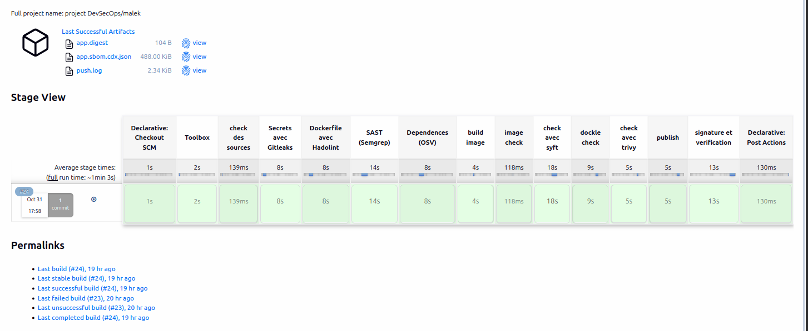

> بسم الله الرحمن الرحيم
>
> pour ce projet DevSecOps, je vais creer un pipeline CI/CD avec Jenkins, en includant Container hardening.
> on commence avec une application basic qui est base sur node js et un interface basique bootstrap.

---

# Projet DevSecOps — Notes App

Projet pédagogique de mise en place d'une chaîne **DevSecOps** complète autour d'une petite application
Node.js de prise de notes. L'objectif est d'industrialiser le cycle de vie de l'application
(build → tests de sécurité → publication signée → déploiement durci sur Kubernetes) en intégrant la
sécurité **dès la conception** (*shift-left*) plutôt qu'en bout de chaîne.

La base fonctionnelle est en place : chaîne CI/CD avec Jenkins as-code, durcissement des
conteneurs, signature Cosign, et déploiement Kubernetes local (cluster **kind** + Cilium + 4 manifests
durcis). Plusieurs briques restent à intégrer pour boucler la boucle DevSecOps — ingress Traefik,
NetworkPolicies default-deny, GitOps avec Argo CD, signature enforcement Kyverno, détection runtime
Falco, packaging — et sont détaillées dans la section [Fonctionnalités à venir](#fonctionnalités-à-venir).

La modélisation des menaces est portée par le [tableau T1–T9](#tableau-des-menaces-t1t9) qui sert de
fil conducteur : chaque contrôle déployé répond à une menace identifiée, et chaque ligne est
associée à une preuve (capture) à constituer.

## Sommaire

- [Présentation](#présentation)
- [Structure du projet](#structure-du-projet)
- [L'application (`App/`)](#lapplication-app)
- [Démarrage rapide](#démarrage-rapide)
- [Pipeline CI/CD avec Jenkins](#pipeline-cicd-avec-jenkins)
- [Durcissement des conteneurs](#durcissement-des-conteneurs)
- [Déploiement Kubernetes](#déploiement-kubernetes)
- [Fonctionnalités à venir](#fonctionnalités-à-venir)
- [Tableau des menaces (T1–T9)](#tableau-des-menaces-t1t9)
- [Limites connues](#limites-connues)
- [Documentation détaillée](#documentation-détaillée)

## Présentation

Le dépôt contient trois briques articulées autour de l'application de notes :

1. **`App/`** — une application Express + PostgreSQL avec une interface Bootstrap 5. Elle expose une
   API REST CRUD sur des notes et sert une page web minimale.
2. **`CI/`** — une infrastructure Jenkins **as-code** (Dockerfile + *Configuration-as-Code* + *Jenkinsfile*)
   qui exécute un pipeline de sécurité complet : analyse de secrets, SAST, scan de dépendances, scan
   d'image, SBOM, signature Cosign, vérification des manifests Kubernetes.
3. **`k8s/`** — un déploiement local sur un cluster **kind** (Kubernetes-in-Docker) avec des manifests
   durcis (namespace `restricted`, `securityContext` strict, `StatefulSet` pour Postgres, `kustomize`).

La philosophie retenue : **aucun outil n'est exécuté directement sur l'hôte Jenkins**. Tous les
scanners tournent dans une image *toolbox* dédiée (`ci-tools:local`), construite à partir de
`CI/jenkins/outils/Dockerfile.secgate` et appelée via une fonction helper du `Jenkinsfile`.



## Structure du projet

```text
.
├── App/                        # Application Node.js (Express + pg + Bootstrap)
│   ├── config.js               #   validation des variables d'env (PORT, PG*)
│   ├── index.js                #   serveur Express + routes REST
│   ├── index.html              #   interface Bootstrap 5
│   ├── logger.js               #   logs JSON structurés sur stdout
│   ├── db/init-db.js           #   pool Postgres + création du schéma `notes`
│   ├── services/               #   create / read / update / ids (requêtes paramétrées)
│   └── test/health.test.js     #   test node:test sur GET /healthz
├── CI/                         # Chaîne CI/CD
│   ├── Dockerfile.naive        #   image de référence, non durcie (node:latest)
│   ├── Dockerfile.alpine       #   image intermédiaire (node:24.11.1-alpine, USER node)
│   ├── Dockerfile.harden       #   image durcie (multi-stage → distroless)
│   ├── cosign.pub              #   clé publique Cosign pour la vérification
│   └── jenkins/
│       ├── Dockerfile          #   image Jenkins LTS (JDK21) pinée par digest + docker CLI
│       ├── jenkins.yml         #   Configuration-as-Code (JCasC)
│       ├── JenkinsFile         #   pipeline declaratif
│       ├── composition-image.yml #  compose : dind + jenkins (port 8080 en 127.0.0.1)
│       ├── plugins.txt         #   liste des plugins Jenkins
│       ├── .env.example        #   secrets attendus (Jenkins, GitHub, Docker Hub, Cosign)
│       └── outils/
│           └── Dockerfile.secgate  # image toolbox contenant les 11 scanners
├── k8s/                        # Déploiement Kubernetes local (kind)
│   ├── kind-config.yml         #   cluster kind (CNI désactivé, NodePort 8081→30080)
│   ├── .env.example            #   identifiants Postgres
│   └── base/
│       ├── namespace.yml       #   namespace `notes` (pod-security: restricted)
│       ├── postgres.yml        #   StatefulSet Postgres durci
│       ├── app.yml             #   Deployment de l'app, image résolue par digest
│       └── kustomization.yml   #   kustomize (namespace + images par digest)
├── Docs/                       # Documentation détaillée
│   ├── PipelineCI.png
│   ├── deployment.md
│   ├── jenkins-config-as-code.md
│   ├── native-hardening-results.md
│   └── threat-model.md         # (à compléter)
├── docker-compose.yml          # Stack locale : app + Postgres
└── .env.example
```

## L'application (`App/`)

Application **Node.js** (`note-taking-app` v1.0.0) basée sur :

- **Express** `^4.18.2` pour l'API HTTP,
- **pg** `^8.23.1` pour PostgreSQL,
- **Bootstrap 5.3** (chargé via CDN avec *Subresource Integrity*) pour l'interface.

### Endpoints

| Méthode | Route        | Description                                  |
|---------|--------------|----------------------------------------------|
| `GET`   | `/healthz`   | Sonde de santé (`{ "status": "ok" }`)        |
| `GET`   | `/`          | Interface web (Bootstrap)                    |
| `POST`  | `/notes`     | Crée une note (`{ title, content }`)         |
| `GET`   | `/notes`     | Liste toutes les notes                       |
| `GET`   | `/notes/:id` | Récupère une note                            |
| `PUT`   | `/notes/:id` | Modifie une note                             |
| `DELETE`| `/notes/:id` | Supprime une note                            |

Points de sécurité notables côté code :

- Requêtes SQL **paramétrées** (`$1, $2, …`) dans `services/create.js`, `read.js`, `update.js` → pas
  d'injection SQL.
- Validation stricte des identifiants (`services/ids.js`) avant toute requête.
- Logs **JSON structurés** sur `stdout` (`logger.js`) pour intégration future à un SIEM.
- Arrêt propre (`SIGTERM`/`SIGINT`) : fermeture du pool Postgres et du serveur avec timeout de 10 s.
- Annotations `// nosemgrep` ciblées pour les faux positifs Semgrep.

### Tests

Les tests utilisent le runner natif `node:test` avec deux rapporteurs : `spec` (console) et `junit`
(fichier `junit.xml`), ce dernier étant consommable par le plugin Jenkins `junit`.

```bash
npm test
```

## Démarrage rapide

### Prérequis

- Docker + Docker Compose (ou `docker compose`),
- (optionnel) Node.js 24+ et PostgreSQL 16 pour un lancement sans Docker.

### 1. Variables d'environnement

Copier le modèle et renseigner un mot de passe fort pour Postgres :

```bash
cp .env.example .env
# .env
APP_PORT=3000
POSTGRES_USER=notes
POSTGRES_DB=notes
POSTGRES_PASSWORD=replace-with-a-strong-password
```

> Le mot de passe est obligatoire : `docker-compose.yml` lève une erreur s'il est absent
> (`POSTGRES_PASSWORD must be set in .env`).

### 2. Lancement avec Docker Compose

La stack lance l'application et un Postgres 16-alpine avec un *healthcheck* `pg_isready`. L'app ne
démarre qu'une fois la base saine (`depends_on: service_healthy`).

```bash
docker compose up -d --build
```

L'application est alors disponible sur `http://localhost:3000` (ou `:$APP_PORT`).

### 3. Lancement en local (sans Docker)

```bash
cd App
npm ci
# dans un terminal : Postgres
# puis :
PORT=3000 PGHOST=127.0.0.1 PGUSER=notes PGPASSWORD=... PGDATABASE=notes npm start
```

## Pipeline CI/CD avec Jenkins

> Voir [`Docs/jenkins-config-as-code.md`](Docs/jenkins-config-as-code.md) pour le récit détaillé.

### Configuration as-code

L'infrastructure Jenkins est entièrement versionnée et reproductible :

- **`CI/jenkins/Dockerfile`** — image `jenkins/jenkins:lts-jdk21` **pinée par son digest SHA-256**
  (`@sha256:a660310e…`) pour garantir la reproductibilité des builds. On installe le CLI Docker
  (les agents en ont besoin) et l'on copie `plugins.txt` + `jenkins.yml`.
- **`CI/jenkins/composition-image.yml`** — deux services :
  - `docker` (Docker-in-Docker `docker:29.9.2-dind`, piné par digest, mode privilégié, TLS via
    `DOCKER_TLS_CERTDIR=/certs`),
  - `jenkins` (construit depuis le Dockerfile ci-dessus, port `8080` exposé **en localhost seulement**,
    communication avec dind via TLS sur le réseau privé `jenkins`).
- **`CI/jenkins/jenkins.yml`** (JCasC, version 2) :
  - *Security realm* local, un seul utilisateur `admin` (mot de passe `${JENKINS_ADMIN_PASSWORD}`),
    inscription désactivée,
  - *Authorization strategy* `loggedInUsersCanDoAnything`, lecture anonyme interdite,
  - **credentials** déclarés : `github-pat`, `dockerhub-pat`, `dockerhub-repo`,
    `cosign-cle` (clé privée Cosign en fichier), `cosign-mdp`,
  - bibliothèque partagée `devsecops-jenkins-biblio-library` récupérée depuis GitHub,
  - job `multibranchPipelineJob` pointant vers `CI/JenkinsFile`.

Démarrage de Jenkins :

```bash
docker compose -f CI/jenkins/composition-image.yml up -d --build
```

### La *toolbox* de sécurité (`outils/Dockerfile.secgate`)

Aucun scanner n'est installé sur l'hôte Jenkins : ils vivent dans une image `ci-tools:local`
construite à partir de `debian:12-slim` (piné par digest). Chaque binaire est téléchargé avec
**vérification de sa somme SHA-256**. Les 11 outils embarqués :

| # | Outil        | Version | Rôle dans le pipeline                                   |
|---|--------------|---------|---------------------------------------------------------|
| 1 | Gitleaks     | 8.30.1  | Détection de secrets dans l'historique Git             |
| 2 | Hadolint     | 2.15.1  | Lint du Dockerfile                                       |
| 3 | Semgrep      | 1.182.1 | Analyse statique (SAST) du code `App/`                  |
| 4 | OSV-Scanner  | 2.7.0   | Scan de vulnérabilités des dépendances                   |
| 5 | Trivy        | 0.76.1  | Scan de vulnérabilités de l'image (`CRITICAL,HIGH`)     |
| 6 | Syft         | 1.55.0  | Génération du SBOM (CycloneDX)                           |
| 7 | Dockle       | 0.4.15  | Bonnes pratiques de construction d'image                 |
| 8 | Cosign       | 3.1.4   | Signature et vérification de l'image                     |
| 9 | kube-linter  | 0.8.3   | Lint des manifests Kubernetes                           |
| 10| kubeconform  | 0.8.0   | Validation des manifests                                 |
| 11| kustomize    | 5.8.3   | Construction des manifests avant validation             |

### Stages du `Jenkinsfile`

```text
Toolbox ──► check des sources ──► build image ──► vérif manifests ──► image check ──► publish ──► signature
              (parallèle)                          (parallèle)        (parallèle)     (main)       (main)
```

| Stage | Outils | Détail |
|-------|--------|--------|
| **Toolbox** | `docker build` | Construit `ci-tools:local` |
| **check des sources** | gitleaks, hadolint, semgrep, osv-scanner | Exécutés **en parallèle** ; hadolint cible `CI/Dockerfile.harden`, semgrep cible `App/` |
| **build image** | `docker build` | Construit l'image durcie `devsecops/app:$GIT_COMMIT` depuis `CI/Dockerfile.harden`, puis `docker save` dans `images/app.tar` |
| **vérif manifests** | kube-linter, kubeconform (+ kustomize) | `kube-linter lint k8s/base/` et `kustomize build k8s/base/ \| kubeconform -strict -summary` |
| **image check** | syft, dockle, trivy | SBOM CycloneDX, bonnes pratiques, vulnérabilités (`--ignore-unfixed`) |
| **publish** *(branche `main`)* | docker login/push | Pousse l'image sur Docker Hub, capture le digest dans `reports/app.digest` |
| **signature et vérification** *(branche `main`)* | cosign | `cosign sign`, `cosign tree`, puis `cosign verify --key CI/cosign.pub` |

Les commandes de sécurité ne tournent pas sur le conteneur Jenkins mais dans la toolbox, via le
helper :

```groovy
def securiteApplicative(String command) {
    docker.image(env.TOOLBOX).inside('-e HOME=/tmp -v /var/jenkins_home/trivy-cache:/trivy-cache') {
        sh command
    }
}
```

Le cache Trivy est monté en volume pour accélérer les scans. Les rapports (`reports/**`) sont
archivés systématiquement en `post { always { archiveArtifacts ... } }`.

### Résultat des scans (image durcie)

Sur l'image durcie, Trivy ne remonte **aucune vulnérabilité** :

```text
Target                  Type      Vulnerabilities   Secrets
app.tar (debian 13.7)   debian         0              -
app/package.json        node-pkg       0              -
app/node_modules/...    node-pkg       0              -   (tous les sous-paquets à 0)
```

> Note : le 30 octobre, le pipeline a signalé une vulnérabilité sur le paquet `minimatch` (10.2.6),
> corrigée par un *override* vers `^11.0.1` dans `App/package.json`.

## Durcissement des conteneurs

> Voir [`Docs/native-hardening-results.md`](Docs/native-hardening-results.md) pour les mesures
> complètes.

Trois variantes d'image sont comparées afin de mesurer l'impact du durcissement :

| Image              | Base                              | Vulnérabilités (Trivy) | Taille disque | Taille contenu |
|--------------------|-----------------------------------|--------------------------|---------------|----------------|
| `notes:naive`      | `node:latest` (Debian 13.7)       | 458 (HIGH 442, CRIT 16)  | 1,8 Go        | 448 Mo         |
| `notes:alpine`     | `node:24.11.1-alpine` (Alpine 3.23) | 21 (HIGH 19, CRIT 2)    | 236 Mo        | 57,5 Mo        |
| `notes:hardened`   | `gcr.io/distroless/nodejs24-debian13:nonroot` | 0            | 210 Mo        | 53,6 Mo        |

Le `Dockerfile.harden` utilisé en production est un build multi-stage :

```dockerfile
FROM node:24.11.1-slim AS build
WORKDIR /app
COPY package.json package-lock.json ./
RUN npm ci --omit=dev
COPY . .

FROM gcr.io/distroless/nodejs24-debian13:nonroot@sha256:a6c34457f6da4295807e051411c7783739c65b997a324fed14e4fa292615ae91
WORKDIR /app
COPY --from=build --chown=65532:65532 /app /app
USER 65532:65532
EXPOSE 3000
CMD ["index.js"]
```

Apports : image *distroless* (pas de shell, pas de gestionnaire de paquets), dépendances de prod
seulement (`npm ci --omit=dev`), exécution en UID/GID `65532` non-root, image pinée par digest.

## Déploiement Kubernetes

> Voir [`Docs/deployment.md`](Docs/deployment.md) pour le déroulé complet.

Le déploiement cible un cluster **kind** local (Kubernetes-in-Docker). Outils : `kind`, `kubectl` et
`kustomize` (`helm` étant disponible mais non utilisé ici).

### 1. Création du cluster

`k8s/kind-config.yml` désactive le CNI par défaut (un CNI dédié sera déployé ensuite) et expose deux
NodePorts en `127.0.0.1` :

```yaml
kind: Cluster
apiVersion: kind.x-k8s.io/v1alpha4
networking:
  disableDefaultCNI: true
nodes:
  - role: control-plane
    extraPortMappings:
      - { containerPort: 30080, hostPort: 8081, listenAddress: "127.0.0.1" }
      - { containerPort: 30443, hostPort: 8443, listenAddress: "127.0.0.1" }
```

```bash
kind create cluster --name devsecops --config k8s/kind-config.yml
kubectl cluster-info --context kind-devsecops
kubectl get nodes
```

### 2. Secrets

L'application a besoin de deux secrets Kubernetes.

**Identifiants Postgres** (`db-credentials`), depuis `k8s/.env` :

```bash
kubectl -n notes create secret generic db-credentials \
  --from-literal=POSTGRES_USER=notes \
  --from-literal=POSTGRES_DB=notes \
  --from-literal=POSTGRES_PASSWORD=<mot-de-passe-fort>
```

**Pull Docker Hub** (l'image de l'app est publiée par le pipeline CI) :

```bash
kubectl -n notes create secret docker-registry dockerhub-pull \
  --docker-server=docker.io \
  --docker-username=<user> \
  --docker-password=<token>
```

### 3. Manifests (`k8s/base/`)

- **`namespace.yml`** — namespace `notes` avec la label
  `pod-security.kubernetes.io/enforce: restricted` (le niveau le plus strict de la *Pod Security
  Admission*).
- **`postgres.yml`** — Postgres déployé en **`StatefulSet`** (et non `Deployment`) pour bénéficier du
  stockage persistant via `volumeClaimTemplates` (PVC 1 Go). Compte Postgres (UID 70), `runAsNonRoot`,
  `seccompProfile: RuntimeDefault`, `readOnlyRootFilesystem: true`, `allowPrivilegeEscalation: false`,
  `capabilities.drop: [ALL]`. Deux `emptyDir` (`/tmp` et `/var/run/postgresql`) sont montés car
  Postgres doit pouvoir écrire à ces emplacements malgré le FS en lecture seule.
- **`app.yml`** — `Deployment` de l'application : `runAsUser: 65532` (non-root), `seccompProfile:
  RuntimeDefault`, mêmes `securityContext` conteneur que Postgres, `imagePullSecrets: dockerhub-pull`,
  ressources CPU/mémoire définies, montage `emptyDir` sur `/tmp`.
- **`kustomization.yml`** — applique le namespace `notes` et **résout les images par digest** plutôt
  que par tag, pour garantir l'immuabilité :

  ```yaml
  images:
    - name: notes-app
      newName: ennajahmalek/projet-dev-sec-ops
      digest: sha256:6ca99166e964ba46aa0ac1f137c669c6d988bbd697a0c8753181d1732890abab
    - name: postgres:16-alpine
      digest: sha256:0cefaabd882e42bcb2a2f3dc56d3ce4770560ba62fd7f197f1a2e008fd5731ab
  ```

### 4. Déploiement

```bash
kubectl apply -k k8s/base/
kubectl -n notes get pods -w
```

Sortie attendue :

```text
NAME         READY   STATUS    RESTARTS   AGE
postgres-0   1/1     Running   0          82s
app-xxxx     1/1     Running   0          20s
```

L'application est ensuite accessible sur l'hôte via le NodePort mappé : **`http://localhost:8081`**
(`30080` dans le conteneur → `8081` sur l'hôte).

### 5. Validation des manifests

Avant application, les manifests sont validés par le pipeline :

```bash
kube-linter lint k8s/base/
kustomize build k8s/base/ | kubeconform -strict -summary
```

Lors des premières itérations, kube-linter a remonté des problèmes (absence de
`readOnlyRootFilesystem`, ressources CPU/mémoire non définies) qui ont ensuite été **corrigés
directement dans les manifests** — la version actuelle de `app.yml` et `postgres.yml` intègre donc
`toutes les remédiations`.

## Fonctionnalités à venir

Les briques suivantes sont planifiées et seront bientôt ajoutées au projet :

- **Ingress Traefik** — exposer l'app via un nom d'hôte (`app.127.0.0.1.nip.io`) sur les ports hôtes 80/443, avec recréation du cluster kind pour mapper ces ports.
- **NetworkPolicies default-deny** — cinq policies Cilium (deny-all, allow-DNS, Traefik→app, app→postgres, postgres←app) vérifiables via Hubble.
- **Démos de sécurité** — pod privilégié rejeté par PSA (T5), mouvement latéral bloqué par netpol (T6), token service-account inutile (T7).
- **Repository GitOps séparé** — second repo pour les manifests, avec un overlay `staging` pinant l'image par digest.
- **Mini-pipeline GitOps** — second `Jenkinsfile` réutilisant la toolbox pour valider les manifests (kube-linter + kubeconform).
- **Argo CD** — déploiement pull-based avec `AppProject` (least privilege) et `Application` en sync auto + self-heal.
- **Stage "update GitOps"** — nouveau stage Jenkinsfile (main only) qui commit le digest signé vers le repo GitOps via `kustomize edit set image`.
- **Kyverno `require-signed-images`** — policy d'admission qui vérifie la signature Cosign avec `CI/cosign.pub` avant de stocker un pod (T8).
- **Kyverno `pod-hardening`** — policy qui ré-applique le profil `restricted` à l'admission (défense en profondeur).
- **Démos de refus Kyverno** — image non signée refusée, image signée avec mauvaise clé refusée.
- **Loki + Grafana** — stack de logs (Loki monolithic + Grafana avec datasource pré-provisionnée) dans le namespace `monitoring`.
- **Alloy** — collecte des logs pods et des events Kubernetes via l'API (remplace Promtail, EOL mars 2026).
- **Falco + Falcosidekick** — détection runtime via eBPF, forwarding des alertes vers Loki (namespace `falco` privilégié).
- **Mesure de latence Falco** — médiane sur 5 runs du temps entre `kubectl exec` et l'alerte Grafana.
- **Packaging** — `Makefile` + `infra/up.sh` pour rebuild le lab complet depuis des scripts pinés, evidence sweep, vidéo de démo, decision records.

## Tableau des menaces (T1–T9)

Tableau de bord du projet : chaque menace identifiée est associée à un contrôle réellement déployé
(ou planifié) et à un fichier de preuve. Les lignes T1–T4 et T9 sont déjà couvertes par le pipeline
actuel ; T5 par le namespace `restricted` déjà en place ; T6/T7/T8 et les lignes Traefik/Argo/Falco
sont les fonctionnalités à venir.

| ID  | Menace                          | Contrôles déployés ou planifiés                                            |        
|-----|---------------------------------|----------------------------------------------------------------------------|  
| T1  | Dépendance compromise           | Gates OSV-Scanner + Trivy, lockfile                                        |                
| T2  | Secret fuité                    | Gitleaks dans Jenkins, GitHub push protection                              |            
| T3  | PR malveillante / Jenkinsfile   | Jenkins check required, credentials seulement dans les stages `main`-only  |          
| T4  | Outil CI empoisonné             | Toolbox pinée par checksum vérifié                                         |  
| T5  | Conteneur root                  | Hadolint, Dockle, kube-linter, PSA `restricted`                            |            
| T6  | Mouvement latéral              | NetworkPolicies default-deny sur Cilium                                    |            
| T7  | Token service-account volé      | `automountServiceAccountToken: false`, un SA par workload, aucun Role      |           
| T8  | Image non signée                | Signature Cosign, policy Kyverno `require-signed-images`                  |        
| T9  | Compromission Jenkins           | JCasC, port localhost-only, DinD, signature sur `main`                     |         
| —   | Entrée cluster non contrôlée    | Ingress Traefik (NodePort + Ingress resource validée par kube-linter)      |           
| —   | Dérive manuelle du cluster      | Argo CD pull-based, `selfHeal: true`                                       |            
| —   | Shell dans un pod non détecté   | Falco + Falcosidekick → Loki, dashboard Grafana                            |            

Chaque cellule vide est un livrable. Une cellule pleine sans preuve est incomplète : capturer la
preuve le jour où le travail est fait, pas après.

## Limites connues

Limites assumées du projet, à nommer explicitement plutôt qu'à cacher — nommer une limite est la
réponse la plus forte en entretien.

- **Staging sans review humaine** : le bot Jenkins commite les bumps de digest directement sur
  `main` du repo GitOps. La production nécessiterait un second overlay, une seconde Application
  Argo CD, et une gate `input` Jenkins qui met en pause avant promotion vers prod.
- **Attestation SBOM absente** : le pipeline produit déjà `reports/app.sbom.cdx.json` (via Syft)
  mais ne l'attache pas à l'image avec `cosign attest`. Une ligne dans le stage `signature` ferme le
  gap — ajout prévu.
- **Falco sur kind** : le probe eBPF inspecte le noyau hôte (les nœuds kind sont des conteneurs
  Docker), donc Falco remonte des syscalls de tout ce qui tourne sur la VM, y compris Jenkins. Le
  bruit est filtré par namespace en démo, mais la limite est réelle.
- **`Docs/threat-model.md`** est actuellement vide (0 octet) — le tableau T1–T9 ci-dessus sert de
  modèle de menaces de facto ; le document `Docs/threat-model.md` reste à rédiger (STRIDE complet
  sur l'app + le pipeline + le cluster), voir [Limites connues](#limites-connues).
- **Pas de monitoring de disponibilité** : pas de sonde Liveness/Readiness sur l'app, pas d'alerting
  sur la latence ou le taux d'erreur. Hors périmètre actuel, à mentionner.
- **Rebuild non-IaC** : le `Makefile` + `infra/up.sh` reconstruisent le lab depuis des scripts, pas
  depuis un vrai outil IaC (Terraform, Pulumi). Acceptable pour un lab pédagogique, à ne pas vendre
  comme de l'IaC.

## Documentation détaillée

La documentation approfondie se trouve dans le dossier `Docs/` :

- [`Docs/jenkins-config-as-code.md`](Docs/jenkins-config-as-code.md) — construction de l'image
  Jenkins, configuration JCasC, composition Docker, et récit des premières exécutions du pipeline
  (gitleaks, hadolint, trivy, gestion du paquet `minimatch`).
- [`Docs/native-hardening-results.md`](Docs/native-hardening-results.md) — comparaison détaillée des
  trois images (naive / alpine / durcie) : comptes Trivy et tailles.
- [`Docs/deployment.md`](Docs/deployment.md) — déploiement sur kind étape par étape, justification du
  `StatefulSet`, *securityContext*, création des secrets, sortie kube-linter.
- [`Docs/PipelineCI.png`](Docs/PipelineCI.png) — schéma du pipeline CI.
- [`Docs/threat-model.md`](Docs/threat-model.md) — modélisation des menaces (actuellement vide — le
  [tableau T1–T9](#tableau-des-menaces-t1t9) sert de modèle de facto ; STRIDE complet à rédiger,
  voir [Limites connues](#limites-connues)).
